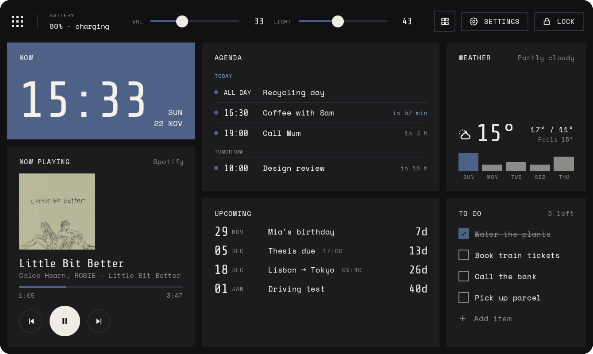
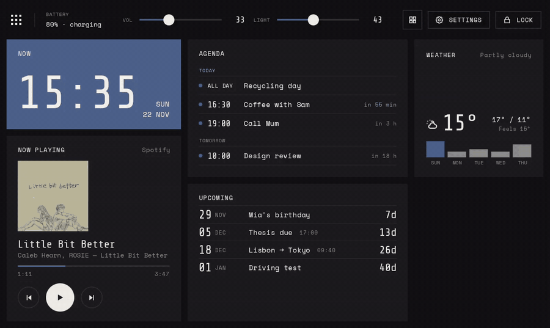
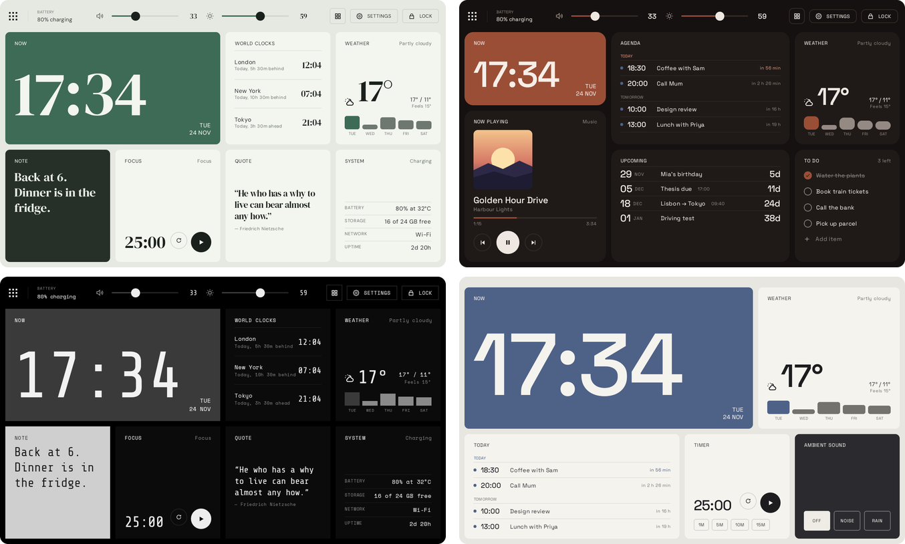
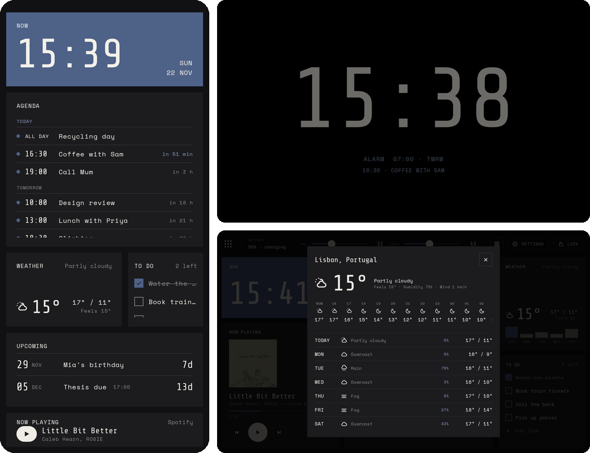

<h1 align="center">Deskdash</h1>

<p align="center">
  An always-on dashboard for the tablet or phone on your desk.<br>
  Clock, calendar, weather, music, alarm and more, as tiles you arrange yourself.
</p>

<p align="center">
  <a href="https://github.com/jupist/Deskdash/releases">Download</a> ·
  <a href="#install">Install</a> ·
  <a href="#build">Build</a> ·
  <a href="CHANGELOG.md">Changelog</a>
</p>



## Arrange it in seconds

Press and hold any tile, then drag it where you want it; the tiles around it make room. Drag a corner to resize, tap a tile for its settings, and undo any step. Save different arrangements as presets and switch between them.

Or do it from your phone: with Deskdash on both and the same Wi-Fi, pair once with a code, then rearrange the tablet's tiles, change their settings, add important dates and set the alarm from the couch. No account or server; the two talk directly over an encrypted connection.

<p align="center"></p>

## Make it yours

Five colour themes, each in dark or light (one follows your wallpaper). Three font sets, or your own font files. Hide the top bar for a cleaner screen, and use any mix of the 18 tiles at any size.



## At home on any screen

Layouts adapt to phones and tablets in portrait or landscape. After the hours you choose, night mode dims everything down to a large clock with your next alarm and event. Tap the weather for the next 24 hours and the week ahead.



## Tiles

| | |
|---|---|
| **Time** | Clock, world clocks, countdowns to dates you add |
| **Calendar** | One agenda from device calendars, iCal links, `.ics` files and Google Calendar |
| **Weather** | Current conditions, hourly and 7-day forecast for your location or any place |
| **Music** | Now playing with art and controls for the music app you choose |
| **Alarm & timers** | Alarm with repeat days and snooze; timer, stopwatch and focus sessions. They ring over the lock screen and survive reboots. |
| **Everyday** | Checklist, sticky note, quote of the day, photo frame |
| **Apps** | Favourite apps, recently used apps, app shortcuts |
| **System** | Battery, storage and network; volume and brightness; ambient rain or noise |

It's also built to stay on: it keeps the screen awake while charging, can be your home screen or screensaver, protects against burn-in, and works offline. There's no account or tracking, and your whole setup exports to a single backup file.

## Install

Download the APK from [Releases](https://github.com/jupist/Deskdash/releases) and open it on your device. Deskdash needs Android 8.0 or newer.

A short setup on first launch covers theme, location, calendars and permissions; you can skip any step and find everything later in **Settings**. A few optional extras:

- **Home screen:** set Deskdash as your home app so it's always there. The ⋮⋮⋮ button opens your other apps.
- **Screensaver:** *Settings › Display & power › Screensaver* shows the dashboard while the device charges.
- **Samsung:** add Deskdash to *Battery › Background usage limits › Never sleeping apps* so alarms aren't delayed.
- **Google Calendar sign-in** needs an OAuth client in your own build ([setup](docs/GOOGLE_CALENDAR.md)). Device calendars and iCal links work without it.

## Build

You need JDK 17 or newer and the Android SDK (platform 35).

```bash
echo "sdk.dir=$HOME/Android/Sdk" > local.properties   # or set ANDROID_HOME
./gradlew assembleRelease
adb install -r app/build/outputs/apk/release/app-release.apk
```

Release builds use the debug key unless you add a git-ignored `keystore.properties` next to `settings.gradle.kts`:

```properties
storeFile=deskdash.jks
storePassword=…
keyAlias=deskdash
keyPassword=…
```

`./gradlew test lintRelease` runs the unit tests and lint, as CI does on every push.

## Code

Kotlin and Jetpack Compose in a single activity, using Compose foundation only (no Material).

| Package | Contents |
|---|---|
| `board/` | Grid model, layout fitting, presets and the drag-and-resize editor |
| `modules/` | The tiles; each is a `Module` with its content and settings |
| `calendar/` | Device, iCal and Google sources merged into one event list |
| `alarm/` | Alarm and timer scheduling, the ringing service and the alarm screen |
| `ui/` | Theme, shared components, settings, night screen and onboarding |
| `remote/` | Remote control: local network discovery, pairing and the encrypted connection |
| `data/`, `system/`, `media/` | Settings, weather, backup, permissions, location and media sessions |

Weather comes from [Open-Meteo](https://open-meteo.com) and place search from [Photon](https://photon.komoot.io). [CREDITS.md](CREDITS.md) lists all data, sound and font sources.
