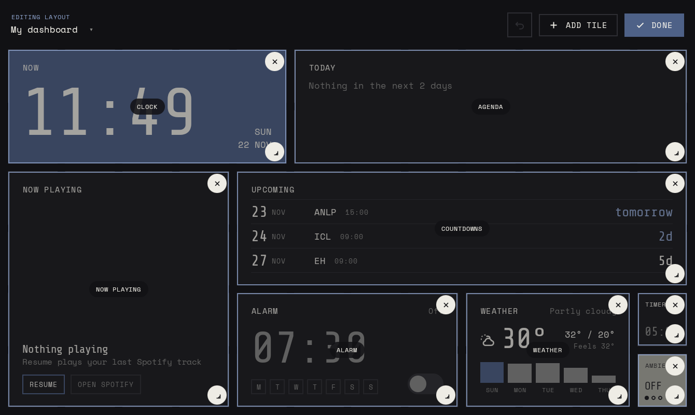

# Deskdash

An always-on dashboard for the tablet or phone on your desk. It shows the clock, calendar, weather, music, alarm, timers and more as tiles you arrange yourself. Run it as an app, as your home screen, or as the screensaver.


## Highlights

- **Arrange it your way.** Long-press a tile to edit the layout. Drag a tile to move it, and the tiles around it make room. Drag the corner to resize, or tap a tile for its settings. Undo goes back step by step, and you can save several layouts as presets.
- **Fits any screen.** The grid adapts to tablets and phones in portrait or landscape. Each orientation keeps its own layout.
- **One agenda.** It combines calendars synced to the device, iCal links, imported `.ics` files and Google Calendar sign-in.
- **Made for a stand.** It keeps the screen on while charging and switches to a dim night clock at the hours you choose. Burn-in protection shifts pixels and cycles a pixel pattern. It works offline.
- **Your look.** Pick from five themes in dark or light (one follows your wallpaper) and three font sets, or add your own font files. You can also change corner style, spacing and text size.
- **Private by default.** There's no account and no tracking, and weather needs no API key. A backup is a single file you export and import.

| Edit mode | Settings | Night mode |
|---|---|---|
|  |  |  |

## Tiles

| | |
|---|---|
| **Time** | Clock, world clocks, countdowns to dates you add |
| **Calendar** | Agenda for today and the coming days |
| **Weather** | Current conditions and the week ahead; tap for the next 24 hours. Uses your location or any place you search for. |
| **Music** | Now playing with controls, for the music app you pick. Resume plays your last track without opening the app. |
| **Alarm & timers** | Alarm with repeat days and snooze; timer, stopwatch and focus sessions. They ring over the lock screen and survive reboots. |
| **Notes** | Checklist, sticky note, quote of the day, photo frame |
| **Apps** | Favourite apps, recently used apps, single-app shortcuts |
| **System** | Battery, storage and network status; volume and brightness sliders; ambient rain or noise |

## Install

Download the APK from [Releases](https://github.com/jupist/Deskdash/releases), or from the latest [build](https://github.com/jupist/Deskdash/actions) run, and install it. It needs Android 8.0 or newer.

On first launch, a short setup asks for theme, location, calendars and permissions, and you can skip any step. Everything is in **Settings** afterwards, where **Permissions** lists each permission and what it's for. Optional extras:

- **Home screen:** set Deskdash as your home app so it's always there. The ⋮⋮⋮ button opens your other apps.
- **Screensaver:** *Settings › Display & power › Screensaver* shows the dashboard, view-only, while the device charges.
- **Samsung:** add Deskdash to *Battery › Background usage limits › Never sleeping apps*, or alarms may be delayed.
- **Google Calendar sign-in** needs an OAuth client in your own build; see [docs/GOOGLE_CALENDAR.md](docs/GOOGLE_CALENDAR.md). Device calendars and iCal links work without it.

## Build

You need JDK 17 or newer and the Android SDK (platform 35). Android Studio is optional.

```bash
echo "sdk.dir=$HOME/Android/Sdk" > local.properties   # or set ANDROID_HOME
./gradlew assembleRelease
adb install -r app/build/outputs/apk/release/app-release.apk
```

To sign with your own key, add a git-ignored `keystore.properties` in the project root. Without it, the build is signed with the debug key.

```properties
storeFile=deskdash.jks
storePassword=…
keyAlias=deskdash
keyPassword=…
```

`./gradlew test lintRelease` runs the unit tests and lint, as CI does on every push.

## Code

The app is Kotlin and Jetpack Compose (foundation only, no Material) in a single activity.

| Package | Contents |
|---|---|
| `board/` | Grid model, layout fitting, presets and the drag/resize editor |
| `modules/` | The tiles, one file per group; each tile is a `Module` with content and settings |
| `calendar/` | Device, iCal and Google sources merged into one event list |
| `alarm/` | Alarm and timer scheduling, the ringing service and the full-screen alarm |
| `ui/` | Theme, shared components, settings, night screen and onboarding |
| `data/`, `system/`, `media/` | Settings stores, weather, backup, permissions, location and media sessions |

Layouts are stored as JSON, settings in DataStore and countdowns in Room.

[CHANGELOG.md](CHANGELOG.md) lists what changed in each release. [CREDITS.md](CREDITS.md) lists the data, sound and font sources.
