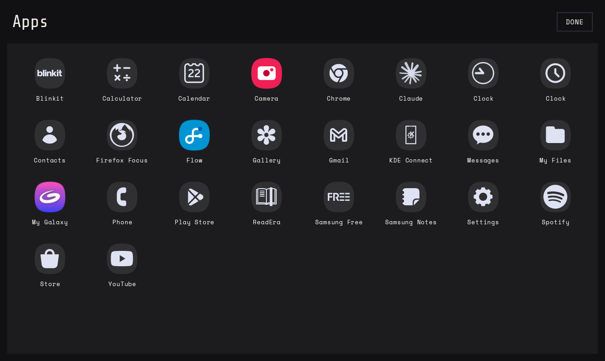

# Deskdash

An always-on desk dashboard for an Android tablet. Clock, calendar, countdowns, weather, music, an alarm and ambient sound on one landscape screen. Built for a Galaxy Tab A7 Lite on a charger, beside a desk or bed.


## Features

- **Clock** that changes exactly on the minute.
- **Today:** the next few events from the calendars on the device (Google, Samsung and others), each with its own on/off.
- **Upcoming:** your own countdown list (exams, deadlines, trips). The three closest fill the tile; the rest scroll.
- **Weather** from [Open-Meteo](https://open-meteo.com) (no API key) for any city or neighbourhood: the current temperature, today's high and low, and five days ahead. The last forecast stays on screen when you're offline.
- **Now playing:** album art, progress and controls for Spotify or any other player, even while it's in the background. When nothing is playing, one tap resumes your last Spotify track.
- **Alarm:** rings over the lock screen and from standby. It has repeat days, a one-time option, snooze, and survives reboots.
- **Ambient sound:** a real rain recording, or soft noise, both looping without a gap.
- **Night mode:** a dim clock showing your next alarm during the hours you choose. Tap it to see the dashboard for 30 seconds.
- **Home-app mode:** starts on boot and opens on Home. The dot icon lists your apps, themed to your palette.
- Volume and brightness sliders, a Lock button, a ReadEra shortcut, and keeps the screen on while charging.

| Night mode | Settings | Apps |
|---|---|---|
|  |  |  |

## Build and install

You need JDK 17 or newer, the Android SDK (platform 35), and `adb`. Android Studio is optional.

```bash
echo "sdk.dir=$HOME/Android/Sdk" > local.properties   # or set ANDROID_HOME
./gradlew assembleDebug
adb install -r app/build/outputs/apk/debug/app-debug.apk
```

Runs on Android 11 or newer, on a landscape tablet. The layout is tuned for 1340 × 800.

## First run

Open **Settings** on the dashboard. Its **Permissions** section lists each permission the app uses, with a Grant button for any it doesn't have yet:

| Permission | Used for |
|---|---|
| Calendar | Today tile |
| Notification access | Now playing |
| Modify system settings | Brightness slider |
| Notifications, full-screen alerts | The alarm, including over the lock screen |
| Device admin (lock only) | Lock button. Turn it off before uninstalling. |
| Unrestricted battery | Stops Android from putting the app to sleep |

On Samsung, also add Desk to **Battery › Background usage limits › Never sleeping apps**. Then set it as the home app under **Display › Use as home app**.

## Project

- Kotlin and Jetpack Compose in a single activity, with no Material components.
- Room stores the dates; DataStore stores settings.
- [`SPEC.md`](SPEC.md) is the full design spec, and [`mockup.html`](mockup.html) is the original visual mockup.
- Sound and font credits are in [`CREDITS.md`](CREDITS.md).
