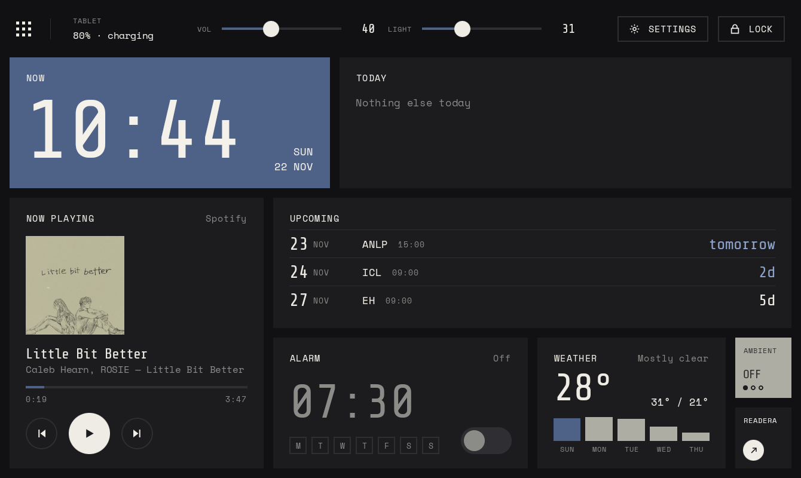
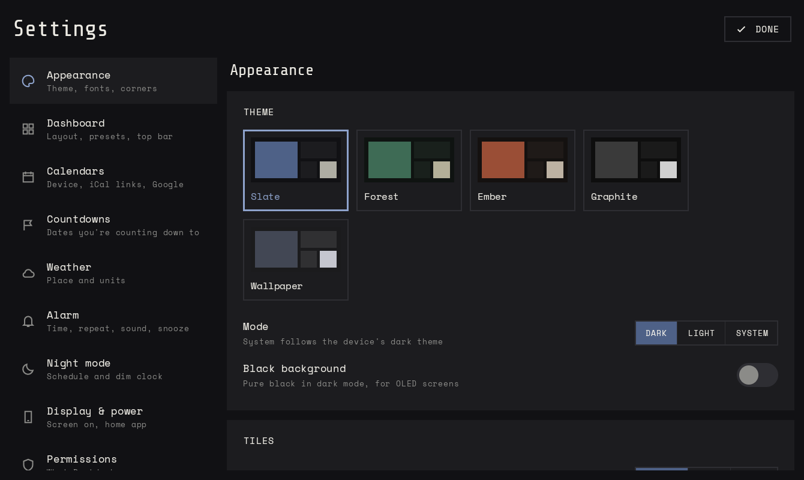
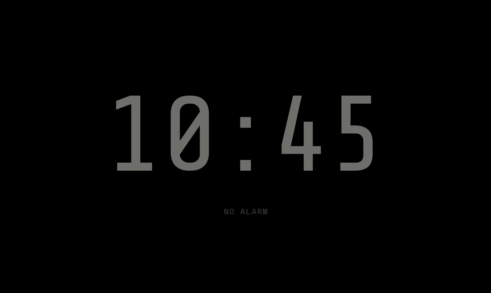

# Deskdash

A customizable, always-on dashboard for an Android tablet or phone on your desk. Clock, calendar, weather, music, alarm, timers and more, arranged as tiles you can move, resize and restyle. Runs as an app or as your home screen.



## Features

- **Your layout:** long-press any tile to rearrange it. Drag to move, drag the corner to resize, tap for its settings. The grid fits any screen, in portrait or landscape, and you can save layouts as presets.
- **Tiles:** clock, agenda, countdowns, weather, now playing (any music app), alarm, timer (countdown, stopwatch and focus), checklist, sticky note, world clocks, photo frame, quote of the day, favourite and recent apps, ambient sound, system status, volume and brightness controls, and app shortcuts.
- **Calendars:** events from calendars synced to the device, iCal links, imported .ics files, or Google sign-in, all in one agenda.
- **Weather** for your location or any city or neighbourhood from [Open-Meteo](https://open-meteo.com), with no account or API key. Tap the tile for the next 24 hours and 7 days.
- **Alarm and timers** ring over the lock screen, survive reboots, and the alarm has snooze.
- **Night mode** dims the screen to a large clock with your next alarm and event, between hours you choose.
- **Your look:** five themes (one taken from your wallpaper), each in dark or light; three font sets or your own font files; plus corner style, spacing and text size.
- **Built for a stand:** keeps the screen on while charging, can be the home app or the screensaver, has an app list behind the dot icon, and works offline.
- **Backup:** export your whole setup to a file and import it on another device.

| Edit mode | Settings | Night mode |
|---|---|---|
|  |  |  |

## Install

Build it yourself (below), or download the APK from [Releases](https://github.com/jupist/Deskdash/releases) or the latest [Build](https://github.com/jupist/Deskdash/actions) run. Needs Android 11 or newer.

## Build

You need JDK 17 or newer, the Android SDK (platform 35) and `adb`. Android Studio is optional.

```bash
echo "sdk.dir=$HOME/Android/Sdk" > local.properties   # or set ANDROID_HOME
./gradlew assembleRelease
adb install -r app/build/outputs/apk/release/app-release.apk
```

To sign release builds with your own key, add a `keystore.properties` file in the project root; it's git-ignored:

```properties
storeFile=deskdash.jks
storePassword=…
keyAlias=deskdash
keyPassword=…
```

Without it, release builds are signed with the debug key. Run the unit tests with `./gradlew test`.

## First run

A short setup walks you through theme, weather location, calendars and permissions; you can skip any step. Everything is in **Settings** afterwards, where **Permissions** shows what's granted and what each permission is for. On Samsung devices, also add Deskdash to *Battery › Background usage limits › Never sleeping apps*.

To use Google sign-in for calendars, the build needs an OAuth client; see [docs/GOOGLE_CALENDAR.md](docs/GOOGLE_CALENDAR.md). iCal links and device calendars need no setup.

## Project

- Kotlin and Jetpack Compose in a single activity, using Compose foundation only (no Material).
- `board/` holds the grid, the layout logic and the editor. `modules/` has one file per group of tiles. `calendar/` merges the event sources.
- Layouts and presets are saved as JSON, settings in DataStore, countdowns in Room.
- [`CHANGELOG.md`](CHANGELOG.md) lists what changed. [`SPEC.md`](SPEC.md) and [`mockup.html`](mockup.html) are the original 0.1 design, and [`CREDITS.md`](CREDITS.md) lists data, sound and font sources.
